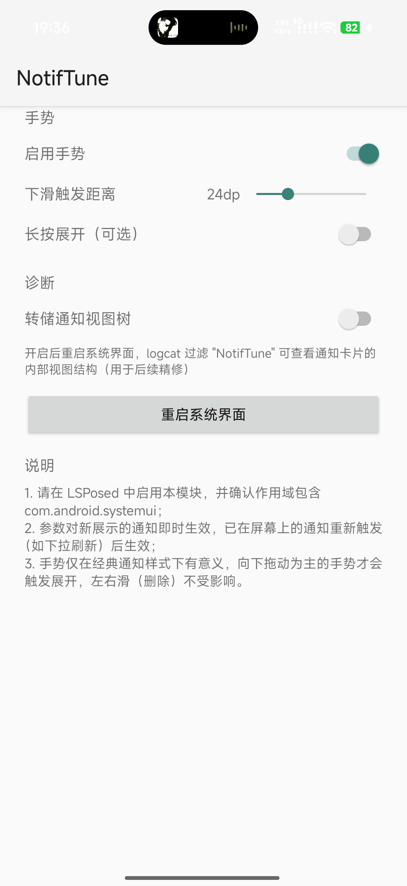

# NotifTune

让小米澎湃OS（HyperOS）的**经典通知样式**支持**原生安卓的下拉展开 / 上滑收回手势**的 LSPosed 模块。

> 背景：澎湃OS切换到「原生样式」后可以按住下滑展开通知，但很多人（包括我）更喜欢经典样式的外观；
> 而经典样式下通知列表滚动时，下拉会被系统当作列表滚动，无法展开通知。
> 本模块只做一件事：把这套原生手势在经典样式下**接回来**。

## 功能

| 手势 | 行为 |
|---|---|
| 在通知上**向下滑** | 展开该通知（官方展开动画） |
| 在通知上**向上滑** | 收回该通知（仅当手指下这条自身处于展开态时） |
| 分组通知（如多条应用消息堆叠） | 分组未展开时下滑 → 展开分组；分组已展开时下滑某条 → 展开该条完整内容 |
| 未展开区域的上下滑动 | 完全不受影响（列表滚动、侧滑删除、上滑关闭通知栏照常） |
| 点按通知 | 照常打开应用，不会被手势误伤 |

## 实现思路（不重新造轮子）

全部复用系统原生机制，模块只做三件事：

1. **展开/收回执行**：调用系统自己的 `ExpandHelper` 回调 `setUserExpandedChild(row, true/false)`
   ——即原生拖开展开松手提交时执行的同一动作。
   （收回方向小米的实现里缺少一次 `notifyHeightChanged` 高度通知，本模块做了补偿，否则"收了但不缩"。）
2. **手势识别**：全局 `dispatchTouchEvent` 钩子 + 坐标命中测试（最上层 z 序优先 + 空白区识别 + 最深视图兜底），
   在通知行上位移超过阈值即触发。
3. **冲突消解**：在列表层与通知面板层做最小化拦截，避免"展开手势变成滚动列表"或"收回手势误关通知栏"；
   所有守卫只在手势进行中生效，其余时刻完全不干预系统行为。

## 兼容性

- 实测设备：Redmi K90 Pro Max（`myron`），澎湃OS 3 / Android 16，LSPosed 2.2.1 + KernelSU
- 作用域：`com.android.systemui`
- 通知样式：**经典样式**（原生样式下系统自带该手势，无需本模块）
- 未在其他机型/系统版本测试，欢迎反馈



## 安装

1. 安装 [APK](https://github.com/AD275/NotifTune/releases)（或从源码构建）
2. 在 LSPosed 中启用模块，作用域勾选 `com.android.systemui`
3. 重启系统界面（或重启手机）
4. 打开模块设置页可调：手势开关、诊断日志开关

## 已知限制

- **跟手逐帧缩放未实现**：拖动过程中行高逐帧跟随手指的"跟手"效果依赖系统 `ExpandHelper` 的实时缩放管线，
  在经典样式下该管线无法产生视觉增长（已尝试到 `startExpanding` + `updateExpansion` 层面）。
  目前展开/收回为官方回调的动画，非逐帧跟手。
- 分组内的收回语义：向上滑只收回"手指下自身已展开"的那一条；展开分组本身不影响。

## 从源码构建

```bash
# 需要 JDK 17 与 Android SDK（compileSdk 36）
echo "sdk.dir=/path/to/android/sdk" > local.properties
./gradlew assembleRelease   # 或使用系统 gradle 8.13+
```

签名使用仓库内的 `notiftune.keystore`（alias/password 见 `app/build.gradle`），
保持与官方发布 APK 相同签名以便覆盖升级。

## 致谢

- 手势机制参考了 [HyperCeiler](https://github.com/Sevtinge/HyperCeiler) 中对 MIUI/HyperOS SystemUI 的钩子实践
- 反编译参考了 AOSP SystemUI 源码

## License

[MIT](LICENSE)
